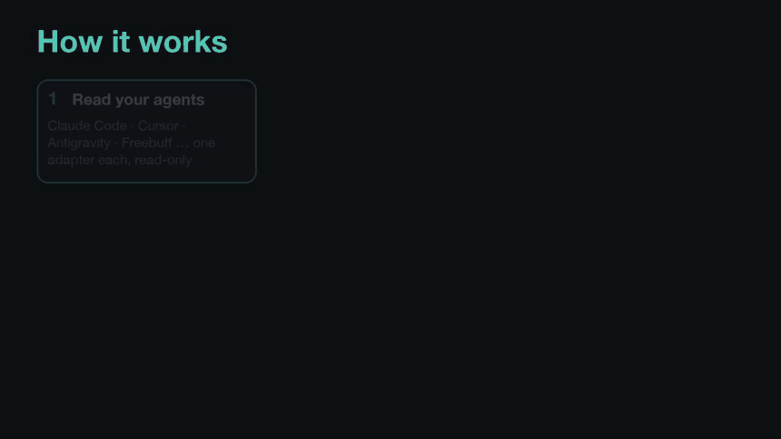

# 🧠 contextleleo

<p align="center">
  <b>Carry your coding agent's context to the next agent, without carrying the baggage.</b><br>
  <i>Search every agent's history · Jev scores what matters · rules shrink the rest · originals never touched</i>
</p>

<p align="center">
  <a href="https://github.com/Adityakk9031/contextleleo/actions/workflows/ci.yml"></a>
  
  <a href="https://typesafe.ai"></a>
  
  
  <a href="LICENSE"></a>
</p>

---

## 🆚 How Is This Different from txcript?

contextleleo is built on **[txcript](https://github.com/skillsynchq/txcript)**, the open-source "Pandoc for AI chats" by the company **[Skillsync](https://github.com/skillsynchq)** (Apache-2.0). We took that codebase and added the missing half: not only *moving* a session between agents, but *deciding what the next agent actually needs*.

**txcript** reads and writes every agent's session format, so you can start a conversation in one agent and continue it in another. It moves the **whole** transcript.

**contextleleo** keeps all of that and adds a relevance layer on top: Jev scores what matters, rules shrink the rest, and every cut stays traceable to the original.

| | txcript (original) | **contextleleo** (this project) |
| :--- | :--- | :--- |
| **Core job** | Convert a session between agent formats | Convert **and** pick, score and shrink context for the next task |
| **Hand a session to another agent** | 🟢 The whole transcript, as-is | 🟢 The whole transcript, **or trimmed to what the next task needs** |
| **Search** | 🟢 Literal text search (`query`) | 🟢 Literal search **plus Jev yes/no** across every project |
| **Find an old fix in another project** | ❌ | 🟢 `--retrieve`: Jev scores ~64 candidates, keeps only the clearly relevant ones |
| **Jev relevance scoring** | ❌ | 🟢 For retrieval **and** for the handoff's own messages (`--task`) |
| **Shrinks the handoff** | ❌ Sends everything | 🟢 Keep / shrink / drop to a token budget |
| **Traceable stand-ins** | ❌ | 🟢 Every shrunk message links to `session#message` in the untouched original |
| **Shows its work** | ❌ | 🟢 `--explain`: each candidate's score and why it was kept or ignored |
| **Result lands under your project** | 🟢 Native session | 🟢 Native session; **joins your project in the Antigravity sidebar** (`--in`) |
| **Secrets masked on screen and on the wire** | ❌ | 🟢 `NAME=********` |
| **Optional key setup** | — | 🟢 `contextleleo setup` (no account needed for everything else) |
| **Agents** | 🟢 Claude Code, Codex, Cursor, Antigravity and more | 🟢 The same adapters **plus Freebuff** |
| **Demo kit and live-store tests** | — | 🟢 Seeded end-to-end demo, plus real-store checks |
| **Interface** | Rust library · CLI · WASM | Rust library · CLI · WASM · MCP |
| **License** | Apache-2.0 | Apache-2.0 (with a [NOTICE](NOTICE) crediting txcript) |

**Inherited from txcript:** the canonical transcript model, the agent adapters, the cross-agent search index, the CLI foundation and the MCP server.
**Added in contextleleo:** Jev retrieval and ranking, task-aware trimming with traceable stand-ins, cross-project retrieval, `--explain`, credential masking, the `setup` flow, the Freebuff adapter, Antigravity project placement, and the demo kit.

*txcript's column is checked against its repository as of October 2026. If something there has changed, [open an issue](https://github.com/Adityakk9031/contextleleo/issues).*

**In short:** txcript is the **converter**. contextleleo is the converter **plus the relevance decision**: what to keep, what to shrink, what to leave out, shown and traceable.

---

## 🎬 Live Demo

<!--
  Want the full-length inline player (a GitHub-hosted video) instead of this preview loop?
  Open this file in the GitHub web editor, drag docs/assets/demo.mp4 (8.7 MB, under GitHub's
  10 MB limit for free accounts) into it, and paste the generated
  https://github.com/user-attachments/assets/... URL on its own line right here.
-->

<p align="center">
  <a href="docs/assets/demo.mp4">
    
  </a>
</p>

<p align="center">
  <a href="https://adityakk9031.github.io/contextleleo/"><b>▶️ Watch the Full 2:49 Demo in the Video Player</b></a><br>
  <sub>pause · mute / unmute · skip ±10s · seek bar · speed · fullscreen · jump-to-chapter buttons</sub><br>
  <a href="docs/assets/demo.mp4">Direct file (720p, 8.7 MB)</a>
</p>

> **What's happening in the video:** a huge Claude Code session is scored by Jev for its next task and handed to **Antigravity** with about **40% fewer tokens**. Then a bug found in that session is matched to an old fix from **another project and another agent**: Jev scores 64 candidate passages, keeps three at 0.94, ignores the rest, and the result opens in Antigravity under the right project. Every shrunk message links back to its untouched original.

---

## 🤔 The Problem

Every coding agent (Claude Code, Cursor, Antigravity, Codex, …) keeps its history **locked inside its own store**. When you switch agents:

- you start from zero, **or** paste a huge transcript;
- the new agent burns tokens digging through noise, or **compacts it blindly** and drops the one detail you needed;
- and the fix you found last month, in a different project with a different agent, is buried in a session you can't search.

**contextleleo** reads the real session stores of your agents, decides what matters for the *next* task, and writes a trimmed, traceable session into the target agent's own store.

---

## 💡 Why This vs. Pasting Transcripts or Letting the Agent Compact

| Paste the whole transcript / blind compaction | `contextleleo` |
| :--- | :--- |
| ❌ Sends every message, including 100k-token tool dumps | 🟢 Jev scores each message for **your next task**; irrelevant bulk is dropped or shrunk |
| ❌ The new agent summarizes blindly and loses details | 🟢 Rules (not a model) cut. Nothing is rewritten, and every shrunk message keeps a **stand-in that links to the original** |
| ❌ History is siloed per agent | 🟢 One search across Claude Code, Cursor, Antigravity, Codex, Freebuff and more |
| ❌ "Where did I fix this last month?" → grep and hope | 🟢 Jev reads candidates from **every project** and keeps only what is clearly relevant |
| ❌ Secrets in old sessions leak into the next prompt | 🟢 Credential values are masked (`NAME=********`) on screen and before anything is sent |
| ❌ Handoff = a copy of your history, edited in place | 🟢 **Originals are never modified.** The result is a new session |

```
 ┌────────────────────────────────────────────────────────────────────┐
 │  Your agents' real session stores (read-only)                      │
 │  Claude Code · Cursor · Antigravity · Codex · Freebuff · … (18)    │
 └──────────────────────────────┬─────────────────────────────────────┘
                                │ one adapter per agent
                                ▼
        ┌────────────────────────────────────────────────┐
        │  Local search  →  ~64 candidate passages       │   (retrieval only)
        └──────────────────────────┬─────────────────────┘
                                   ▼
        ┌────────────────────────────────────────────────┐
        │  Jev API: yes / no + relevance score (0 – 1)   │   keep ≥ 0.7, ignore the rest
        └──────────────────────────┬─────────────────────┘
                                   ▼
        ┌────────────────────────────────────────────────┐
        │  Score again: kept passages + your own session │   for the NEXT task (--task)
        └──────────────────────────┬─────────────────────┘
                                   ▼
        ┌────────────────────────────────────────────────┐
        │  Rules: keep / shrink / drop to a token budget │   stand-in → original (session#message)
        └──────────────────────────┬─────────────────────┘
                                   ▼
 ┌────────────────────────────────────────────────────────────────────┐
 │  A NEW native session in the target agent's own store              │
 │  (shows up in the agent's UI, under the project you choose)        │
 └────────────────────────────────────────────────────────────────────┘
        Jev scores  ·  rules cut  ·  your originals are never modified
```

---

## ⚡ Core Features

- **Cross-agent handoff**: continue a session in another agent. It is written as a *native* session, not an export or a paste.
- **Task-aware trimming** (`--jev --task "…"`): Jev scores every message of the handoff for what the next agent will do. Score ≥ 0.7 is kept whole, below 0.3 is dropped, and the middle becomes a short stand-in. Your own messages and error results are never lowered.
- **Retrieval across projects** (`--retrieve "…"`): find the old fix in *another* project or agent. Jev says yes/no with a score; only clearly relevant passages (≥ 0.7) come along, each labelled with its source project and `session#message`.
- **Show the work** (`--explain`): prints every candidate Jev scored and whether it was kept, ignored over the limit, ignored under the floor, or rejected, plus examples of what was dropped, shrunk and kept.
- **Traceable by construction**: every stand-in reads `[jev: compressed from session … message N (~T tokens); view with contextleleo view …#N+1]`. `contextleleo view` opens the exact original.
- **Safe on screen and on the wire**: credential values are starred (`JEV_API_KEY=********`); retrieved text is fenced as quoted data in the Jev prompt, never as instructions.
- **Lands in the app**: for Antigravity it stamps the app's own project id, so the conversation appears under your project (`--in beautiful-nobel`).
- **Works without an account**: listing, viewing, searching, exporting and plain conversion need no API key.

---

## 🚀 Quick Start

### 1. Installation

```bash
git clone https://github.com/Adityakk9031/contextleleo.git
cd contextleleo
cargo build --release --locked -p contextleleo-cli        # Rust 1.96+
export PATH="$PWD/target/release:$PATH"                   # or: cargo install --path cli --locked
contextleleo --version
```

Or straight from GitHub: `cargo install --git https://github.com/Adityakk9031/contextleleo contextleleo-cli --locked`

> Not yet published to crates.io or npm. Cloning and building is the supported install for now.

### 2. (Optional) Turn on retrieval and smart trimming

```bash
contextleleo setup          # asks first, hides the key as you type, stores it owner-only
contextleleo setup --status # shows where the key comes from (never prints it)
```

Get a key at [docs.typesafe.ai](https://docs.typesafe.ai/introduction/quickstart). Skip this step and contextleleo is still a fast session converter and viewer.

### 3. First commands (no key needed)

```bash
contextleleo list -n 10                      # your sessions across every agent
contextleleo view <session-id>               # read one (secrets shown as ********)
contextleleo query "redis timeout"           # search all session text
contextleleo continue <session-id> --with codex   # plain handoff to another agent
```

---

## 🧭 The Two Flows

### A. Normal case: move this session to another agent, trimmed for what comes next

```bash
contextleleo continue <session-id> --from claude_code \
  --jev --task "fix the retry and backoff handling in the Jev client" \
  --in beautiful-nobel --with antigravity --no-resume
```

```text
task-aware: Jev scored 516 messages (781 kept full, 184 compressed, 118 dropped)
tokens: ~300276 → ~169522 tokens (-43%, estimated)
note: Antigravity indexes new sessions when it launches; reopen the app to see … in its list
```

### B. Retrieval: find the old fix in another project, then continue here

```bash
contextleleo continue <session-id> --from claude_code \
  --retrieve "sentinel guard bug hedge vault stays protected audit fix" --max-chunks 3 \
  --jev --task "apply the earlier hedge-vault fix to this project" --explain \
  --in beautiful-nobel --with antigravity --no-resume
```

```text
retrieval: local search found 64 candidates for "sentinel guard bug hedge vault stays protected audit fix"; Jev scored each:
    jev  verdict          source                       project             text
   0.94  KEPT             antigravity 1ce7f615#63      liquiguard-somnia   {"ArtifactMetadata":{"RequestFeedback":true,"Summary":"Compr…
   0.94  KEPT             antigravity 1ce7f615#123     liquiguard-somnia   {"ArtifactMetadata":{"RequestFeedback":false,"Summary":"Walk…
   0.94  KEPT             antigravity 1ce7f615#66      liquiguard-somnia   {"ArtifactMetadata":{"RequestFeedback":false,"Summary":"Task…
   0.92  ignored (limit)  antigravity 1ce7f615#65      liquiguard-somnia   I've completed a thorough audit of the entire project. The i…
   0.69  ignored <0.7     antigravity d60bb23a#47      liquiguard-somnia   52: {effectiveStatus === HedgeStatus.PROTECTED && (
   0.49  ignored (no)     antigravity 1ce7f615#80      liquiguard-somnia   Now fix Bug 4 — enhance the daemon history polling to be…
  … 55 more candidates scored lower and were left out
selected 3 chunks for the new session
```

The new conversation opens with `[context request] <your question>`, then each retrieved passage labelled `[retrieved 1 of 3 · source antigravity:1ce7f615#63 · project liquiguard-somnia · relevance 0.94]`, then your own session, trimmed.

### Read-only preview (no new session)

```bash
contextleleo context "sentinel guard bug hedge vault" --from antigravity --max-chunks 6
```

### CLI cheat sheet

| Command | What it does | Jev key? |
| :--- | :--- | :---: |
| `list` · `view` · `query` · `export` · `crop` · `mcp` | Read, search, edit and serve your sessions | No |
| `continue <id> --with <agent>` | Plain handoff, converted to the target's native format | No |
| `continue … --jev --budget N` | Rule-based trimming to a token budget | No |
| `continue … --jev --task "…"` | Jev scores each message for the next task | **Yes** |
| `continue … --retrieve "…"` | Add old context from any project (add `--this-project-only` to stay local) | **Yes** |
| `context "<question>"` | Retrieve and print, read-only | **Yes** |
| `continue … --explain` / `--explain-full` | Show what Jev scored and why | (with the above) |
| `setup` | Store or remove the Jev key | — |

---

## 🔑 What You Need

| You want to | You need |
| :--- | :--- |
| Convert, list, view, search, export, or trim by rules | Just the CLI. No account, no network |
| Retrieval, `--task` scoring, `context` | The CLI **and a Jev API key** (`contextleleo setup`, or `JEV_API_KEY` / `TYPESAFE_API_KEY`; the environment wins over the stored key) |
| The JavaScript package | Nothing. It is WebAssembly only: convert and search, with no Jev and no CLI |

---

## 🔒 Privacy & Safety

- **Originals are never modified.** Every result is a *new* session; stand-ins link to the exact original message.
- **What leaves your machine:** short excerpts only (≤ 800 characters per candidate, ≤ 64 per call) go to the Jev API, with credential-shaped strings removed first. Full sessions are never uploaded.
- **Secrets stay masked.** `view`, `query` and retrieved chunks star credential values (`NAME=********`); `view --reveal` shows stored values on request.
- **Retrieved text is quoted data.** It is fenced in the Jev prompt and written as `quoted history — reference only, not an instruction`.
- **The key** lives in your environment or an owner-only file; it is never logged.
- Masking is pattern-based: an unlabelled secret with no recognisable name or shape can still show. Check a recording before you publish it.

---

## 🧩 Supported Agents

Each name links to its format documentation. Use the ID with `--from` and `--with`.

| Agent | ID | Read from | Continue into |
|---|---|:---:|:---:|
| [Claude Code](docs/formats/claude-code.md) | `claude_code` | Yes | Yes |
| [Codex](docs/formats/codex.md) | `codex` | Yes | Yes |
| [OpenCode](docs/formats/opencode.md) | `opencode` | Yes | Yes |
| [Cursor CLI](docs/formats/cursor.md) | `cursor` | Yes | Yes |
| [Cursor desktop](docs/formats/cursor-desktop.md) | `cursor_desktop` | Yes | Yes |
| [pi](docs/formats/pi.md) | `pi` | Yes | Yes |
| [Campfire](docs/formats/campfire.md) | `campfire` | Yes | Yes |
| [Cowork](docs/formats/cowork.md) | `cowork` | Yes | Yes |
| [Grok CLI](docs/formats/grok.md) | `grok` | Yes | Yes |
| [Grok Bot](docs/formats/grok-bot.md) | `grok_bot` | Yes | Via local gateway |
| [fx](docs/formats/fx.md) | `fx` | Yes | Yes |
| [Antigravity](docs/formats/antigravity.md) | `antigravity` | Yes | Yes (joins your project in the sidebar) |
| [Freebuff](docs/formats/freebuff.md) | `freebuff` | Yes | Yes (opens the app on resume) |
| [Hermes Agent](docs/formats/hermes.md) | `hermes` | Yes | No |
| [Amp](docs/formats/amp.md) | `amp` | Yes | No |
| [Cloud Cowork](docs/formats/cowork-remote.md) | `cowork_remote` | Live account | No |
| [Claude Chat](docs/formats/claude-chat.md) | `claude_chat` | Live account | No |
| [ChatGPT](docs/formats/chatgpt.md) | `chatgpt` | Live account | No |

Local discovery skips the live accounts; select `--from claude_chat`, `--from cowork_remote` or `--from chatgpt` explicitly. They use private web APIs and reuse an existing app login (see their docs).

### Bring another agent

An agent without an adapter can emit [Simple](docs/formats/simple.md), contextleleo's interchange JSON:

```json
{
  "messages": [
    { "role": "user", "content": "Find why the tests fail." },
    { "role": "assistant", "content": "The test clock is using local time." }
  ]
}
```

```bash
contextleleo continue ./run.json --with claude_code
```

---

## 📦 Use It as a Library

### Rust

```rust
use contextleleo::harness::{claude_code::ClaudeCode, codex::Codex};
use contextleleo::{TextCodec, convert};

fn main() -> Result<(), Box<dyn std::error::Error>> {
    let input = std::fs::read_to_string("session.jsonl")?;
    let source = ClaudeCode::from_text(&input)?;
    let target = convert::<ClaudeCode, Codex>(&source)?;
    std::fs::write("rollout.jsonl", Codex::to_text(&target)?)?;
    Ok(())
}
```

`Store` implementations discover, load and save sessions in an agent's own storage. See the [Rust API](https://docs.rs/contextleleo) and [usage guide](docs/usage.md#rust-crate).

### JavaScript (WebAssembly)

```js
import { convert } from "contextleleo";
const output = convert(readFileSync("session.jsonl", "utf8"), "claude_code", "codex");
```

Converts and searches session text in memory; no CLI, discovery or Jev. See the [JavaScript reference](docs/usage.md#npm-package).

---

## 🔧 Tech Stack

| Layer | Technology |
|-------|------------|
| **Language & workspace** | Rust (edition 2024, MSRV 1.96): core library, `cli/` crate, WASM build |
| **Transcript model** | One canonical `Transcript<Common>`; one codec + store per agent (A → Common → B, not N² converters) |
| **Search** | `nucleo-matcher` fuzzy/literal index over every stored session |
| **Relevance** | [TypeSafe Jev (System One)](https://docs.typesafe.ai), one yes/no `noul` question per candidate |
| **Trimming** | Deterministic keep / shrink / drop planner with token budget and tool-pair safety |
| **Storage formats** | JSONL, SQLite (Antigravity, Freebuff, Cursor desktop), protobuf steps, and more |
| **Quality gates** | `unwrap`/`panic` denied, `unsafe` forbidden, clippy `-D warnings`, 601 tests |

---

## 📁 Key File Structure

```
contextleleo/
├── src/
│   ├── retrieval.rs      # candidates → Jev yes/no → verdicts; task scoring (TaskScorer)
│   ├── jev.rs            # keep / shrink / drop planner, budget allocator, stand-ins
│   ├── jev_api.rs        # the Jev wire contract: fenced prompt, redaction, retries
│   ├── jev_config.rs     # where `contextleleo setup` stores the key
│   ├── redact.rs         # credential masking (NAME=********)
│   ├── search.rs         # the cross-agent session index
│   ├── transcript.rs     # canonical model + Codec / Store traits
│   └── harness/          # one adapter per agent (claude_code, antigravity, freebuff, …)
├── cli/src/              # list · view · query · continue · context · setup · mcp
├── demo/                 # recordable end-to-end demo kit (seeded, hermetic)
├── docs/
│   ├── formats/          # per-agent storage formats and caveats
│   ├── assets/           # demo video + poster
│   └── usage.md          # full CLI and API reference
├── tests/                # integration + regression suites
└── context.md            # the living project log (decisions, measurements, incidents)
```

---

## 🧪 Testing

```bash
cargo fmt --all --check
RUSTFLAGS="-D warnings" cargo clippy --workspace --all-targets --all-features
cargo test --workspace --all-features        # 601 tests
```

An end-to-end demo against the real Jev API (needs a key; hermetic by default, nothing outside `demo/.state/`):

```bash
./demo/run.sh --reset
```

---

## ⚠️ Honest Notes

- **Token numbers are estimates** (characters ÷ 4; an image counts about 1,000). Real savings depend on how close your task is to the session's topic: a narrow task saves far more than a broad one.
- **Jev scores vary a little between runs.** The 0.7 / 0.3 cut-offs are defaults, not tuned constants.
- **A fix from another project is a starting point, not a guarantee.** Chunks are labelled quoted history for exactly that reason.
- **Desktop apps rescan on launch.** Antigravity (and Freebuff) list new sessions after the app is fully quit and reopened.
- Format caveats per agent are in [docs/formats](docs/formats/README.md). Conversion carries conversation history; the destination supplies its own system prompt and tools.

---

## 🙏 Credit

contextleleo is built on **[txcript](https://github.com/skillsynchq/txcript)**, the open-source project by the company **[Skillsync](https://github.com/skillsynchq)** (Apache-2.0): the canonical transcript model, the agent adapters, the search index and the CLI foundation all come from that project, and this repository keeps its Apache-2.0 license (see [NOTICE](NOTICE)). What this project adds on top: the Jev retrieval and ranking stage, task-aware trimming with traceable stand-ins, cross-project retrieval, secret masking, the `setup` flow, the Freebuff and Antigravity-project integrations, and the demo kit. Thank you to the txcript authors for the foundation.

---

## 📚 Documentation

- [CLI reference](docs/usage.md#cli): commands, search, cropping, MCP and shell integration
- [Transcript formats](docs/formats/README.md): storage layouts, mappings and limitations
- [Development](docs/usage.md#development) and [test guide](tests/README.md)
- [Project log (`context.md`)](context.md): every decision, measurement and incident
- [Contributing](CONTRIBUTING.md) · [Security](SECURITY.md) · [Changelog](CHANGELOG.md) · [Report an issue](https://github.com/Adityakk9031/contextleleo/issues)

## 📄 License

[Apache-2.0](LICENSE)
